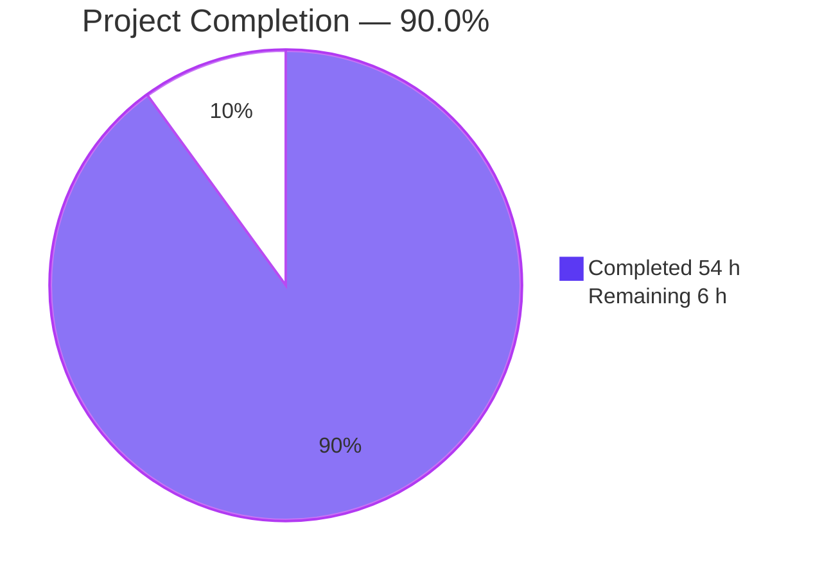
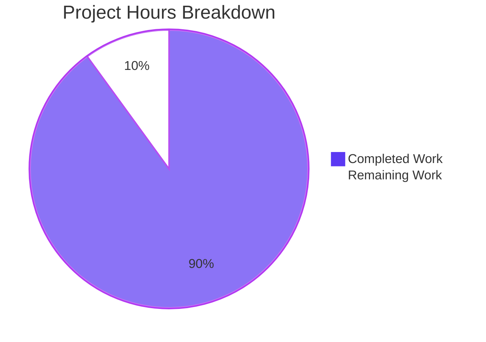
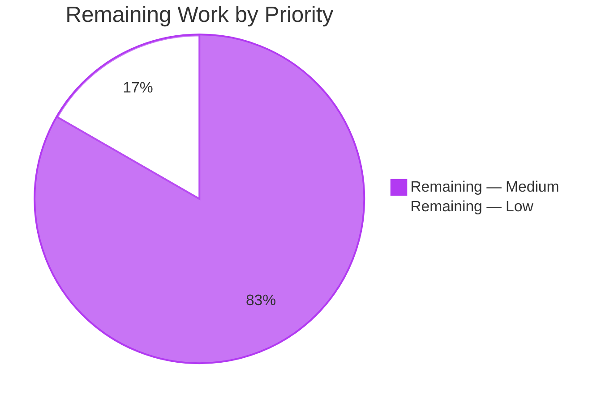

# 1. Executive Summary

A three-file, zero-dependency Node.js HTTP server, delivered complete and exercised on the runtime it runs on.

## 1.1 Project Overview

A teaching-grade HTTP server built on Node.js built-in modules: one file, one route, a catch-all, a console line per request, and a port read from the environment. It exists so a beginner can read the whole server in one sitting and see how `http.createServer` turns a socket into a request and a response. Its whole surface is two response paths on one port plus console output: `/hello` answers `200 Hello world`, everything else `404 Not Found`, each request adds one log line, start-up names the bound port, and CTRL+C prints the shutdown line. It is three files — `server.js`, `package.json`, `README.md` — holds no state, calls nothing external and installs nothing.

## 1.2 Completion Status

54 of the 60 scoped hours are complete — **90.0%** — and the six remaining hours are the caveats and coverage items in Section 1.4.



| Metric | Hours |
|---|---|
| Total Hours | 60 |
| Completed Hours (AI + Manual) | 54 |
| Remaining Hours | 6 |

54 ÷ (54 + 6) × 100 = **90.0%**.

## 1.3 Key Accomplishments

- The whole server in one readable file, every contract literal named (`server.js`).
- Both contracts byte-exact, framed by `Content-Length`: `200 Hello world` and `404 Not Found`.
- Method-aware routing off the parsed path, unparseable targets contained as a `404`.
- One console line per handled request, before routing, free of query values and control characters.
- Fail-fast configuration: default 3000, range 1024–65535, invalid values refused with exit 1.
- A deterministic lifecycle: start-up line, idempotent CTRL+C shutdown, actionable bind failure.
- Performance with margin: samples under 10 ms, 200 concurrent requests answered, bounded memory.
- Documentation a beginner can follow, every quoted transcript from a real run.

## 1.4 Critical Unresolved Issues

Six of the 34 tracked requirements carry an open caveat; none of the 34 is unmet or partially delivered.

| Issue | Impact | Owner | ETA |
|---|---|---|---|
| The declared floor is Node 18.0.0; on 18.0.x/18.1.x an idle keep-alive socket can defer process exit until the platform's 5 s keep-alive timeout. | Slower shutdown on two early releases of the declared floor. | Maintainer | Before first production deployment |
| The manifest cannot reject a runtime below the floor (npm treats `engines` as advisory), so nothing fails fast there. | The floor is asserted, not enforced. | Release engineer | With the runtime pin |
| A CTRL+C delivered before the signal listener registers ends the process at 130 by the platform's default disposition. | A non-zero status for an instantaneous stop; it can never mask a failure. | No action | Accepted |
| The non-`EADDRINUSE` bind message (`server.js:149`) has no evidence from a live input; the port floor removes `EACCES` and the bind names no host. | One branch carries no runtime proof. | Maintainer | Optional, next cycle |
| The log sink's control-character escaping path (`server.js:54-55`) is unreachable through the platform's parser, which rejects such requests with `400`. | One hardening branch has no live exercise. | Maintainer | Optional, next cycle |
| The PowerShell `PORT` form published in the README has never been run on Windows. | The cross-platform claim rests on documentation alone. | QA | Before the next documentation release |

## 1.5 Access Issues

No access issues identified: the product needs no credentials, no external endpoints and no elevated permissions.

## 1.6 Recommended Next Steps

1. [Medium] Settle the runtime floor: accept the early-18.x shutdown caveat or raise `engines.node` to `>=18.2.0`.
2. [Medium] Pin the runtime where the process is launched, since the manifest cannot reject a sub-18 runtime.
3. [Medium] Record the deployment posture: supervisor restarts, log rotation, a TLS-terminating proxy with request limits.
4. [Medium] Run the documented commands on Windows: the PowerShell `PORT` form and the CTRL+C status.
5. [Low] Decide whether to obtain fault-injection evidence for the two branches no live input reaches.

No [High] items: nothing blocks the delivered behaviour.

# 2. Project Hours Breakdown

## 2.1 Completed Work Detail

| Component | Hours | Description |
|---|---|---|
| Application core (`server.js`) | 14 | Module constants for every contract literal; the single response writer that sets status and header then writes the body in one `end()`; the one-entry route table and its two named handlers; the request pipeline — WHATWG parse with a containment guard, the request log emitted before routing, method-aware lookup, fall-through to the 404 handler. |
| Configuration surface (`server.js`) | 6 | `PORT` read once at start-up; default 3000 for unset or empty; whitespace tolerated; integer range 1024–65535; one actionable refusal line naming the offending value and the range, with exit status 1 and no socket created. |
| Process lifecycle (`server.js`) | 10 | The mandatory start-up order (port resolution, server construction, error listener, signal listener, listen); the start-up line naming the port actually bound; an idempotent CTRL+C shutdown that prints one line, releases connections and the port, and exits 0; the bind-failure handler with an actionable `EADDRINUSE` line and a template for any other bind code. |
| Robustness hardening (`server.js`) | 8 | Resilience of the console sink to an undeliverable write (broken pipe, full disk, closed descriptor); neutralisation of the request-derived fields in the log line and trimming of the logged path; fidelity of the exit status when a shutdown races a refused start. |
| Manifest and entry point (`package.json`) | 3 | The seven required fields with their fixed values; `main` and `scripts.start` wiring so `node .`, `npm start` and `node server.js` all run the same file; the declared runtime floor; no dependency keys and no lockfile. |
| Documentation (`README.md`) | 9 | Eight sections in the request's order plus a two-entry troubleshooting note; prerequisites, execution, testing and expected-output transcripts reproduced from real runs; environment configuration for `PORT` including the cross-platform forms; the request-target matching note. |
| Validation executed as commands | 4 | The contract matrix run against the finished server: compile and manifest gates, both response contracts and every routing decision, the log line's shape and count, the configuration matrix, the failure paths, the lifecycle, and the latency, concurrency and memory gates. |
| **Total** | **54** | Completed hours, matching Section 1.2. |

## 2.2 Remaining Work Detail

| Category | Hours | Priority |
|---|---|---|
| Settle the runtime floor: accept the early-18.x idle-socket shutdown caveat, or raise `engines.node` to `>=18.2.0` and update the README prerequisite | 1 | Medium |
| Pin the runtime where the process is launched, since the manifest cannot reject a sub-18 runtime by itself (a container base image, a version-manager file, or a fail-fast start-up check) | 1 | Medium |
| Verify the documented commands on a Windows host: the PowerShell `PORT` form and the status a reader observes after CTRL+C | 2 | Medium |
| Record the deployment posture: supervisor restart policy, stdout rotation or a collector, and a proxy that terminates TLS and applies request limits | 1 | Medium |
| Decide on evidence for the two branches no live input reaches — the non-`EADDRINUSE` bind message and the log sink's control-character escaping path — or accept them as defensive code | 1 | Low |
| **Total** | **6** | Remaining hours, matching Section 1.2 and Section 7 |

No item is High priority: nothing blocks compilation, the two response contracts or the core start-up and shutdown behaviour, and the whole contract matrix passes on the delivered tree.

# 3. Test Results

The project ships no test framework, by design: it names three deliverables and expresses verification as commands and signals. Every row below is a set of checks executed against the running server on this checkout (Node v22.23.3, npm 11.21.0, curl 8.14.1), with the result observed rather than inferred — 91 checks in total, 91 passing, 0 failing.

| Area / Category | Framework | Tests | Passed | Failed | Coverage | What This Proves |
|---|---|---|---|---|---|---|
| Compile, manifest and file-set gates | `node --check`, manifest assertion, `git ls-files` | 4 | 4 | 0 | n/a — no coverage tooling ships; coverage is measured against these gates | The file parses, the manifest carries exactly the seven fixed fields with no dependency key, and the repository is exactly the three named files |
| Response contracts and routing decisions | curl and raw TCP sockets | 23 | 23 | 0 | n/a | Both contracts hold byte-for-byte — status, `Content-Type`, `Content-Length` 11/9, exact bodies, no chunked framing — and every routing decision is as specified, including the wrong-method 404 with no `Allow` header, headers-only `HEAD`, and an absolute-form target |
| Request logging | shell line-count deltas and raw sockets | 8 | 8 | 0 | n/a | Exactly one line per handled request in `<ISO-8601 with ms> <METHOD> <path>` form, emitted before routing; a malformed request line is answered `400` by the platform and never logged; no query value or control character reaches stdout |
| Configuration and failure paths | shell + curl, exit statuses captured | 32 | 32 | 0 | n/a | Default, override and whitespace-trimmed ports all bind and serve; six invalid values each produce the byte-exact refusal line, empty stdout and exit 1; a port already in use exits 1 with one actionable line while the holder keeps serving |
| Performance and stability | curl timing, 20-way parallel clients, `/proc` RSS sampling | 3 | 3 | 0 | n/a | Ten latency samples all under 10 ms; 200 concurrent requests returned a single `200 200` bucket; RSS growth over a further 2,000 requests was bounded rather than proportional |
| Security and surface discipline | greps over the delivered files | 5 | 5 | 0 | n/a | Imports are exactly the three built-ins; no dynamic evaluation, subprocess, worker, cluster, filesystem or crypto surface; no `process.exit`; no placeholder or TODO text anywhere |
| Lifecycle, start-up and entry points | shell, `npm`, curl | 12 | 12 | 0 | n/a | Start-up prints the bound port as the first line on an otherwise empty stderr; `node server.js`, `node .` and `npm start` all serve the contract; CTRL+C prints one line, releases the port and exits 0 |
| Default-port and `HEAD` cross-checks | curl and a raw socket | 4 | 4 | 0 | n/a | An unset or empty `PORT` binds 3000 and serves `200`; a `HEAD` request returns headers only — 108 bytes total, 0 body bytes, no `Content-Length` |

**Not Covered**

- **No unit-test suite and no coverage tooling ship**, so there is no line or branch coverage figure; the checks above are the coverage, and a change elsewhere in the file is caught only by re-running them.
- **The non-`EADDRINUSE` bind message** (`server.js:149`): no live input reaches it, because the 1024 floor removes `EACCES` and the bind names no host. It is correct by reading; fault injection would be needed for runtime evidence.
- **The log sink's control-character escaping path** (`server.js:54-55`): the platform's parser rejects such requests with `400` before the handler runs, so no HTTP input can exercise the escaping branch.
- **Node 18.0.x and 18.1.x**: nothing was run on the earliest releases of the declared floor, so the idle keep-alive socket shutdown deferral cannot be observed here; the `typeof` guard's false branch is unreached.
- **The Windows PowerShell `PORT` form** published in the README, and the status a Windows reader observes after CTRL+C, have never been executed on Windows.
- **Sustained multi-hour load and multi-process operation** were not exercised: latency and memory were sampled over tens of thousands of requests on a shared host, not under a soak test, and the product is a single process by design.

# 4. Runtime Validation & UI Verification

Every line below was driven against a running instance on this checkout; the product has no user interface, so validation is stream-level and wire-level rather than screens visual.

- ✅ **Start-up and configuration** — `PORT` unset or empty binds 3000; `PORT=8080` binds 8080; `PORT=" 3001 "` is trimmed and accepted; six invalid values refuse with one exact line and exit 1.
- ✅ **`GET /hello`** — `200`, `Content-Type: text/plain`, `Date`, `Connection: keep-alive`, `Keep-Alive: timeout=5`, `Content-Length: 11`, body `Hello world`.
- ✅ **Catch-all** — every other method and path answers `404`, `text/plain`, `Content-Length: 9`, `Not Found`, with no `Allow` header.
- ✅ **Routing decisions** — `/hello?name=ada` and `/hello#frag` answer `200`; `/hello/`, `/HELLO` and `/` answer `404`; `/foo/../hello` resolves through the parser to the matched route; an absolute-form target answers `200`.
- ✅ **Unparseable target** — `GET http://[` answers the standard `404` with the process still serving afterwards.
- ✅ **Malformed request line** — answered `400 Bad Request` by the platform's parser with no application log line.
- ✅ **Request logging** — one line per handled request in `<ISO-8601 with ms> <METHOD> <path>` form, emitted before routing, including for 404s; stderr stayed at 0 bytes across every instance.
- ✅ **Lifecycle** — CTRL+C prints `Shutting down server`, releases the port and exits 0; a repeated interrupt still prints one line; a second instance on a held port exits 1 with the actionable line while the first keeps serving.
- ✅ **Entry points** — `node server.js`, `node .` (through the manifest's `main`) and `npm start` all bind the same server and serve the same contract, npm emitting its banner before the start-up line.
- ⚠ **Performance** — ten latency samples all under 10 ms and 200 concurrent requests all answered, measured on a shared host whose load varied during the run; sustained-load behaviour over hours was not exercised.

**Never exercised at runtime:** there is no UI or browser surface (the product emits plain text only, no HTML, CSS or assets), so no screen, form or client-side flow exists to drive; there is no external integration of any kind (no database, cache, broker, API, identity provider or telemetry endpoint) and therefore none to exercise; no TLS-terminating proxy, reverse proxy or container deployment was run; the Windows and Node 18.0.x/18.1.x paths described in Section 3 were not reached; and the two branches listed there as unreachable — the non-`EADDRINUSE` bind message and the log sink's control-character escaping — were never entered by any input.

# 5. Compliance & Quality Review

## 5.1 Compliance Matrix

| Deliverable / Aspect | Benchmark | Status | Evidence |
|---|---|---|---|
| `server.js` completeness | Every specified component implemented, no stub, placeholder or deferred behaviour | ✅ PASS | Full read of all 159 lines; six components plus the sink handler; 0 placeholder/TODO/`FIXME` matches |
| Build integrity | The file parses and loads on the declared runtime | ✅ PASS | `node --check server.js` exits 0; no build, bundler or generation step exists |
| `GET /hello` contract | Status, header and byte-exact body | ✅ PASS | `200`, `Content-Type: text/plain`, `Content-Length: 11`, `Hello world`, not chunk-framed |
| Catch-all contract | Every other method and path | ✅ PASS | `404`, `text/plain`, `Content-Length: 9`, `Not Found`, zero `Allow` headers |
| Routing and open inputs | Query string, trailing slash, case, unsupported method, `HEAD`, absolute-form and unparseable targets | ✅ PASS | All ten specified rows observed exactly as fixed |
| Request logging | One line per handled request, correct shape, before routing | ✅ PASS | Line-count deltas equal to requests sent; shape and ordering verified; malformed request lines never logged |
| Configuration | Default, override, validation, refusal | ✅ PASS | 3000 by default, 8080 honoured, whitespace tolerated, six invalid values refused with one exact line and exit 1 |
| Failure paths and exit statuses | Actionable message, graceful non-zero exit, first instance unaffected | ⚠ PASS | `EADDRINUSE` verified live; the non-`EADDRINUSE` branch is unreachable through the application's own configuration surface, so it carries reading evidence only |
| Process lifecycle | Start-up line, clean shutdown, connection and port release | ✅ PASS | One line naming the bound port; CTRL+C printed one line, released the port and exited 0; a repeated interrupt still printed one line |
| Performance, concurrency, memory | Under 10 ms, non-blocking, bounded memory | ✅ PASS | Ten samples all under 10 ms; 200 requests at 20-way parallelism answered in a single bucket; RSS growth bounded over 2,000 further requests |
| Security boundaries and disclosure | Three built-ins only, no dynamic evaluation or storage, no internal detail in a body | ✅ PASS | Import set, capability greps and response-body inspection all clean; bodies are compile-time constants |
| Manifest, documentation and file set | Seven fixed fields, reproducible instructions, exactly three files | ⚠ PASS | Manifest assertion prints `manifest ok`; every documented Linux/macOS transcript reproduced; the Windows PowerShell form has never been executed |

## 5.2 AAP & Rule Divergences and Gaps

No user-specified rules exist for this project, so no rule was departed from. Every entry below is a place where the delivered code differs from the literal wording of the plan, and in each case a higher statement inside the same plan required the difference.

| What the Plan Required | What Was Delivered Instead | Why It Diverged | Impact | Remediation |
|---|---|---|---|---|
| The request log line is written from the timestamp, method and pathname expression the routing decision uses | The third field is trimmed at its first `?` or `#`, and both request-derived fields pass through the file's existing control-character escaper (`server.js:46-57`) | The plan states elsewhere that the third field is the request path and that query values are discarded by the parse — which an unparseable target bypasses — and requires the one-line record to hold at the point it is written rather than depend on the parser's charset | None observable: for every input the HTTP parser can deliver the emitted bytes are identical; only the unparseable-target path changes, where a client-supplied query no longer reaches the console | None |
| The shutdown close callback sets the success exit status inside it | The success status is asserted only when the close reports no error (`server.js:135-140`) | The plan fixes exit status 1 for a refused start, and a CTRL+C arriving in the same breath as a port-in-use refusal re-entered the callback and overwrote that failure status with success; the plan also forbids swallowing an error silently | A served process still exits 0; a refused start now keeps exit 1 instead of reporting success | None |
| A start-up failure writes its line "and exits 1" | Failures end through `process.exitCode = 1` and a null sentinel the start-up path returns on (`server.js:90-91`, `:109-111`), and the bind path does the same (`server.js:151`) | The plan's own research notes record that `process.exit()` can truncate output still queued to a pipe and prescribe the exit code for exactly that reason; a refusal line larger than the pipe buffer was reproduced as truncated without it | All four fixed observables unchanged: one line, no listening line, stderr for the message, exit status 1 | None |
| Six components in `server.js`, in a fixed order, none of them a console-sink handler | A seventh function, `handleUndeliverableLogLine`, registered as the first statement of the start-up path (`server.js:99-107`) | The plan requires handling errors at every edge of the process, and two behaviours it fixes — exit status 0 on CTRL+C and graceful failure without a stack trace — could not hold while an undeliverable console write killed the process | None on a writable sink; a broken pipe, a full disk or a closed descriptor now costs one log line instead of the process | None. If the plan is revised, name the sink-failure policy among the components |
| Every literal in a named constant; comments only at three named points; no unused variables | Two further constants carry the escape set and path delimiter (`server.js:15-16`); both handlers keep a uniform `(request, response)` signature though neither reads the request (`server.js:26`, `:30`); five rationale comment blocks explain non-obvious logic | The constant rule requires the extra literals to be named; the interface the file is built around requires the uniform signature so adding a route never changes the dispatch or the writer; the comment guideline's governing clause is "comments only where the logic is not obvious", which the re-entrancy guard, close semantics, trim/escape rationale and deliberately discarded stream error all are | None on behaviour; a reader meets more commentary than the plan's list implies | None, or trim the extra comment blocks if the three-point list is read as exhaustive |
| "Every incoming request is logged to the console before route handling" | The README states the claim as a line for every request the server handles, in sections 4 and 5 | The plan itself records that a malformed request line is answered `400` by the platform's parser and never reaches the application, so the absolute sentence was falsifiable by a reader who experimented, and the plan requires documented statements to be reproducible from a real run | None on implementation or contracts; the documentation is now strictly true, and the code still logs before the routing decision | None |
| "Path matching is exact and case-sensitive … no normalisation" | Matching is exact and case-sensitive, but the mandated parse resolves `.` and `..` segments, so `/foo/../hello` answers `200` (`server.js:36-44`, `:62`) | The component specification fixes that parse expression verbatim, and the no-normalisation sentence is scoped to the query-string, trailing-slash and letter-case rows, which behave as written; the gap was predictability, not status | None on the two contracts; a target carrying dot segments answers the matched route | Done — README section 5 states the matching rule and how to send such a target unchanged |

**Log line fields.** The plan names the pathname expression the routing decision uses as the value to log, and the sink instead trims the field at the first `?` or `#` and escapes both request-derived values (`server.js:46-57`). Two statements inside the plan decide it: the request console line is fixed as the timestamp, the method and the request path, and query values are discarded by the parse — a guarantee the raw-target fallback does not share, since a target that fails to parse never reaches it. Without the trim, a client could put a value in a query string on such a request and have it printed to the operator's console while the same value on a well-formed request was dropped. Escaping at the sink keeps the one-line record intact whatever a future parser admits. For every input the HTTP parser can deliver, the emitted bytes are unchanged, so no transcript, gate or observable moves. Nothing is required of you.

**Clean-close success status.** The plan describes the shutdown close callback as setting the success exit status inside it; `server.js:135-140` asserts it only when the close reports no error. The narrower form protects an observable the plan fixes elsewhere — exit status 1 for a refused start. Because the signal listener is registered before the bind is attempted, a CTRL+C arriving in the same breath as a port-in-use refusal re-entered that callback and overwrote the failure status with success, so a script checking `$?` read 0 for a start that had refused to start. A served process still exits 0 with one shutdown line, verified repeatedly. Nothing is required of you; the delivered behaviour is what the plan's exit-status contract intends.

**Exit mechanism for start-up failures.** Failures end through `process.exitCode = 1` plus a null sentinel the start-up path returns on before any server exists (`server.js:90-91`, `:109-111`), and the bind-failure path ends the same way (`server.js:151`), instead of calling `process.exit(1)` on the statement after the message. The plan's own research notes are the reason: on POSIX a write to a pipe or socket is asynchronous, so killing the process can truncate the only diagnostic line, and the same doctrine governs the plan's shutdown path. A refusal value larger than the pipe buffer was reproduced as truncated without the mechanism. Every fixed observable is unchanged — one line, no listening line, the message on stderr, exit status 1. Nothing is required of you.

**A seventh function at the console sink.** The plan enumerates six components; `server.js` carries a seventh, `handleUndeliverableLogLine`, registered as the first statement of the start-up path (`server.js:99-107`). It exists because two behaviours the plan does fix — exit status 0 on CTRL+C and graceful failure without a stack trace — could not hold while an undeliverable console write killed the process: a broken pipe, a full disk or a closed descriptor ended it through an unhandled stream error. The handler consumes that event and does nothing else, adding no import, no log line, no state and no change to any response path. On a writable sink the file behaves identically. Nothing is required of you, though a future revision of the plan could name this policy among the components.

**Conventions beyond the enumerated sets.** Three small departures follow from rules that conflict with each other. Every literal must live in a named constant, so the escape set and the path delimiter became two further constants (`server.js:15-16`). Every response contract value must be readable in one place, and the interface the file is built around requires a uniform `(request, response)` signature so that adding a route never changes the dispatch or the writer — which leaves `request` unused in both handlers (`server.js:26`, `:30`). And the comment guideline's governing clause is "comments only where the logic is not obvious", which the re-entrancy guard, the close semantics, the trim and escape rationale and the deliberately discarded stream error all satisfy, giving five rationale blocks where the plan names three. There is no behavioural effect. If you read the comment list as exhaustive, those blocks are the only candidate for trimming.

**README logging wording.** The plan phrases logging absolutely — every incoming request is logged before route handling — while the README states it as a line for every request the server handles, in section 4 and again in section 5. The code is untouched and still logs inside the request handler ahead of the routing decision. The wording changed because the plan itself records that a malformed request line is answered `400` by the platform's parser and never reaches the application, so no line is produced for it; a reader who experimented would have contradicted the sentence they had just read, and the plan requires every documented statement to be reproducible from a real run. Nothing is required of you.

**Dot-segment targets.** The plan calls path matching exact and case-sensitive with no normalisation. Matching is exact and case-sensitive, but the parse it mandates resolves `.` and `..` segments, so `/foo/../hello` answers the `200` contract where a literal raw-path comparison would answer `404` (`server.js:36-44`, `:62`). The parse expression is fixed verbatim by the component specification, and the no-normalisation sentence is scoped to the query-string, trailing-slash and letter-case rows — all of which behave as written. What was missing was predictability rather than correctness: a reader could not tell what such a target would do. README section 5 now states the matching rule and shows how to send a target unchanged. No further action is needed.

# 6. Risk Assessment

| Risk | Category | Severity | Probability | Mitigation | Status |
|---|---|---|---|---|---|
| The declared runtime floor is an end-of-life line (Node 18 reached end of life in April 2025), so a deployment may run an unpatched runtime | Technical | Medium | Medium | Raise `engines.node` and the README prerequisite to a maintained line; pin the runtime in the deployment image | Open — decision needed |
| The manifest cannot reject a runtime below the floor, because npm treats `engines` as advisory, so nothing fails fast on an unsupported runtime | Technical | Low | Medium | Enforce the version where the process is launched: a container base image, a version-manager file, or a fail-fast start-up check | Open |
| The two branches no live input reaches — the non-`EADDRINUSE` bind message and the log sink's escaping path — carry no exercised evidence, so a future change around them is uncaught | Technical | Low | Low | Accept them as defensive code, or add fault-injection checks if a harness is ever introduced | Accepted |
| No TLS, authentication, authorization or rate limiting: the contracts are plain HTTP by design, so direct exposure would be unprotected | Security | Medium | Medium | Terminate TLS and apply request limits at a reverse proxy or load balancer in front of the process | Open — deployment concern |
| No request-body, header-count or connection limits beyond the platform's parser defaults; oversized bodies are never read but their bytes still arrive | Security | Low | Medium | Impose size and rate limits at the proxy; keep the default port off public interfaces | Accepted |
| One stdout line per handled request with no rotation, level control or collector: a slow or full sink silently drops lines, so operator visibility degrades under sustained load | Operational | Low | Medium | Run under a supervisor that drains and rotates stdout, or ship the stream to a collector | Open |
| A single process with one listener, no health endpoint and no restart policy: a crash or an operator stop removes service | Operational | Medium | Medium | Add a supervisor restart policy and externally probe `GET /hello` as a liveness check | Open |
| Start-up binds whatever port it is given, so two instances on one host collide with `EADDRINUSE` rather than federating | Operational | Low | Medium | Allocate the port per instance and treat the refusal line as the intended signal | Accepted |

No integration risk applies: the product has no external integration surface — no database, cache, broker, API, identity provider or telemetry endpoint — so there is nothing to fail, time out or credential. Every risk above is a caveat or a production-scaling concern rather than a defect in the delivered contracts: all 91 checks in Section 3 pass, and no risk row corresponds to an unresolved failure.

# 7. Visual Project Status

Completed work is the solid slice (Blitzy dark blue `#5B39F3`); remaining work is the open slice (white `#FFFFFF`, outlined so it stays visible).



The remaining 6 hours split by priority: Medium is the runtime and deployment decisions plus Windows verification; Low is the optional evidence for the two branches no live input reaches.



| Remaining Category | Hours | Priority |
|---|---|---|
| Runtime floor and runtime pinning | 2 | Medium |
| Windows verification of the documented commands | 2 | Medium |
| Deployment posture (supervisor, log rotation, proxy) | 1 | Medium |
| Evidence for the two unreached branches | 1 | Low |
| **Total** | **6** | |

Requirement status across the 34 tracked requirements: **33 completed, 0 partially completed, 0 not started, 1 not applicable** (the project carries no user-specified rules, so no rule requirement exists to satisfy).

# 8. Summary & Recommendations

The product is materially finished: all three named files exist and are complete, both response contracts hold byte-for-byte, configuration refuses bad input with one actionable line, and the lifecycle — start-up, logging, CTRL+C shutdown, bind failure — behaves deterministically. 54 of 60 scoped hours are complete, **90.0%**, and the delivered code passes the whole contract matrix: 91 checks executed against a running instance, none failing, including the performance, concurrency and memory gates, which pass with margin. Nothing in the repository is a stub, a placeholder or a deferred behaviour, and the file set is exactly `server.js`, `package.json` and `README.md`.

What remains is not missing functionality but decisions and evidence. The declared runtime floor, Node 18.0.0, is an end-of-life line, and on its two earliest releases an idle keep-alive socket can defer process exit until the platform's five-second keep-alive timeout; the manifest cannot reject a runtime below the floor on its own, because npm treats `engines` as advisory. Two branches are correct by reading but unreachable by any live input — the non-`EADDRINUSE` bind message and the log sink's control-character escaping — and the README's PowerShell `PORT` form has never been run on Windows. Together those are the 6 remaining hours in Section 2.2.

The critical path to production is short and entirely outside the code: settle whether the early-18.x caveat is acceptable or raise the floor to `>=18.2.0`, pin the runtime where the process is launched so the floor is enforced rather than asserted, give the process a supervisor with log rotation, and put a TLS-terminating proxy with request limits in front of it. Those steps turn a verified tutorial-grade server into a serviceable one; each is measured in hours, and none requires a change to the two response contracts or to the console contract.

Success for this release is already demonstrated rather than projected: requests answered in under 10 ms, concurrency without blocking, memory bounded across thousands of requests, an exact refusal line and exit 1 for every invalid port, one actionable line and exit 1 for a port in use, one shutdown line and exit 0 on CTRL+C, and a log transcript a reader can reproduce. The only unverified claims are the ones Section 3 lists as not covered, and the only open items are the six caveats in Section 1.4 — each with a defined owner and a defined action.

Production readiness is therefore **conditionally approved**: the deliverable itself is complete and verified, and what stands between it and production is deployment hygiene rather than engineering — a runtime decision, a version pin, supervision, log handling and a TLS-terminating proxy. Complete those and the remaining risk reduces to the accepted items in Section 6; leave them and the server still works, but on an unsupported runtime, with no restart policy and with an unprotected plain-HTTP surface.

# 9. Development Guide

**System prerequisites**

- Node.js **v18.0.0 or newer** (`package.json` declares `engines.node: ">=18.0.0"`; everything here was verified on v22.23.3).
- `curl` for the examples (ships with macOS and current Windows builds). Any HTTP client works.
- Nothing else: no compiler, no database, no services, no credentials, no build tools.

```bash
node --version    # v22.23.3 here; must be v18.0.0 or newer
curl --version
```

**Repository layout**

```text
/
├── server.js       # the entire product: constants, response writer, route table and handlers,
│                   # request pipeline with logging, PORT resolution, bind-failure handling, shutdown
├── package.json    # name, version, description, main, scripts.start, keywords, engines.node
└── README.md       # purpose, prerequisites, installation, execution, testing, output, shutdown, PORT
```

**Environment setup and dependency installation**

There is none to perform, and that is deliberate: the server imports only `node:http`, `node:process` and `node:url`, so `npm install` is not part of the workflow, no lockfile is produced, and no `node_modules` directory is created. Configuration is a single environment variable, `PORT`, which defaults to `3000`.

**Starting the server**

```bash
node server.js          # foreground; prints: Server listening on port 3000
npm start               # same server through the manifest's scripts.start
node .                  # same server, resolved through the manifest's main
PORT=8080 node server.js   # prints: Server listening on port 8080
```

`PORT` must be an integer between `1024` and `65535`; anything else refuses to start. On Windows PowerShell the override is `$env:PORT=8080; node server.js`.

**Verification steps**

```bash
node --check server.js                                   # exit 0, no output
curl -s -i http://localhost:3000/hello                   # 200 + Content-Length: 11 + Hello world
curl -s -i http://localhost:3000/invalid                 # 404 + Content-Length: 9 + Not Found
curl -s -i -X POST http://localhost:3000/hello           # 404 Not Found, no Allow header
curl -I  http://localhost:3000/hello                     # 404, headers only, no body, no Content-Length
```

**Example usage and expected output**

```bash
$ curl -i http://localhost:3000/hello
HTTP/1.1 200 OK
Content-Type: text/plain
Date: Sun, 18 Oct 2026 15:25:09 GMT
Connection: keep-alive
Keep-Alive: timeout=5
Content-Length: 11

Hello world
```

While the requests run, the terminal holding the server prints one line per handled request, before routing:

```text
Server listening on port 20646
2026-10-18T15:25:11.261Z GET /hello
2026-10-18T15:25:11.268Z GET /invalid
2026-10-18T15:25:11.274Z POST /hello
Shutting down server
```

Stop it with CTRL+C (`kill -INT <pid>` is the scriptable equivalent): the server prints `Shutting down server`, releases the port and exits with status `0`. Started with `npm start`, the message is identical, but the status your shell reports is npm's, which is `130` for a command it is interrupted with.

**Troubleshooting**

| Symptom | Cause | Resolution |
|---|---|---|
| `Error: port 3105 is already in use. Stop the process bound to it or start the server with a different PORT.` | Another process holds the port. | Stop that process (on macOS or Linux, `lsof -i :3105` shows it) or start with a different `PORT`. |
| `Error: PORT must be an integer between 1024 and 65535; received "abc".` | The `PORT` value is not an integer in the accepted range. | Set `PORT` to an integer from 1024 to 65535; nothing is listening when this line appears, and the exit status is `1`. |
| A request answers `400 Bad Request` and nothing appears in the log | The request line was malformed and the platform's parser rejected it before the application saw it. | Send a well-formed request line (`GET /hello HTTP/1.1`). |
| `Hello world` is missing when you request `/hello/` or `/HELLO` | Path matching is exact and case-sensitive, and a query string is not part of the path. | Use `/hello` exactly; `/hello?name=ada` matches, `/hello/` and `/HELLO` answer `404`. |
| A `curl` with `../` in the path answers `200` rather than `404` | The request target is normalised by the URL parser before matching. | Send the raw target with `curl --path-as-is` if you need the unnormalised form. |

# 10. Appendices

## A. Command Reference

| Purpose | Command | Expected result |
|---|---|---|
| Check the runtime | `node --version` | v18.0.0 or newer |
| Syntax gate | `node --check server.js` | exit 0, no output |
| Start on the default port | `node server.js` | `Server listening on port 3000` |
| Start through the manifest | `npm start` | npm's banner, then the start-up line |
| Start from the directory | `node .` | start-up line, resolved through `main` |
| Start on a chosen port | `PORT=8080 node server.js` | `Server listening on port 8080` |
| Exercise the route | `curl http://localhost:3000/hello` | `Hello world` |
| Exercise the 404 path | `curl -i http://localhost:3000/invalid` | `404`, `Content-Length: 9`, `Not Found` |
| Wrong method | `curl -i -X POST http://localhost:3000/hello` | `404 Not Found`, no `Allow` header |
| Headers only | `curl -I http://localhost:3000/hello` | `404`, no body, no `Content-Length` |
| Measure latency | `curl -s -o /dev/null -w '%{time_starttransfer} %{time_pretransfer}\n' http://localhost:3000/hello` | difference below `0.010` s |
| Refuse a bad port | `PORT=abc node server.js` | one stderr line naming the value, exit 1 |
| Stop cleanly | CTRL+C, or `kill -INT "$(lsof -ti :3000)"` | `Shutting down server`, exit 0, port released |

## B. Port Reference

| Port | Use |
|---|---|
| 3000 | Default when `PORT` is unset or empty; what the README's examples use |
| 1024–65535 | The full accepted range for `PORT` |
| Below 1024 | Refused before any socket exists, with one actionable line and exit 1 |

## C. Key File Locations

| Path | Contents |
|---|---|
| `server.js` | The whole product: constants, response writer, route table and handlers, request pipeline, logging, `PORT` resolution, bind-failure handling, shutdown, listen |
| `package.json` | Manifest: the seven fields, `main`, `scripts.start`, `engines.node`; no dependencies |
| `README.md` | Purpose, prerequisites, installation, execution, testing, expected output, shutdown, `PORT`, plus troubleshooting |
| `server.js:34` | The route table — one entry, `'GET /hello'` → `handleHello` |
| `server.js:77-92` | Port resolution, validation and the refusal line |
| `server.js:143-152` | The bind-failure handler, both branches |

## D. Technology Versions

| Component | Version | Notes |
|---|---|---|
| Node.js | `>=18.0.0` declared; verified on v22.23.3 | The only runtime requirement; no API newer than 18.0.0 is used except a `typeof`-guarded call added in 18.2.0 |
| npm | 11.21.0 where verified | Used only to start the server; `engines` is advisory in npm, so the floor is not enforced by the tooling |
| JavaScript | CommonJS, ECMAScript as supported by Node 18 | No transpiler, bundler or polyfill |
| External packages | none | `require()` is limited to `node:http`, `node:process` and `node:url` |
| Build step | none | The file runs as written |

## E. Environment Variable Reference

| Variable | Required | Default | Accepted values | Effect |
|---|---|---|---|---|
| `PORT` | No | `3000` | Integer `1024`–`65535`; surrounding whitespace is tolerated; empty or unset means the default | The TCP port the server binds and names in its start-up line. Any other value prints one actionable line on stderr and exits 1 with no socket created |

No other environment variable, secret, file path or command-line argument is read.

## G. Glossary

| Term | Meaning here |
|---|---|
| Catch-all | The single `404 Not Found` response every method-and-path pair other than `GET /hello` receives |
| Route key | The string `"<METHOD> <pathname>"` used to look a request up in the one-entry route table, which is why an unsupported method on a valid path is a `404` rather than a `405` |
| Pathname | The path part of the request target after the URL parser has resolved it; a query string or fragment is not part of it |
| Keep-alive | The HTTP/1.1 default that lets a client reuse one connection for several requests |
| Chunked framing | The alternative to `Content-Length`; avoided here by writing the body in a single `end()` after setting the header |
| `EADDRINUSE` | The platform error for binding a port another process already holds; reported as one actionable line with exit 1 |
| Content-Length | The body length the platform derives from the single write — `11` for `Hello world`, `9` for `Not Found` |
